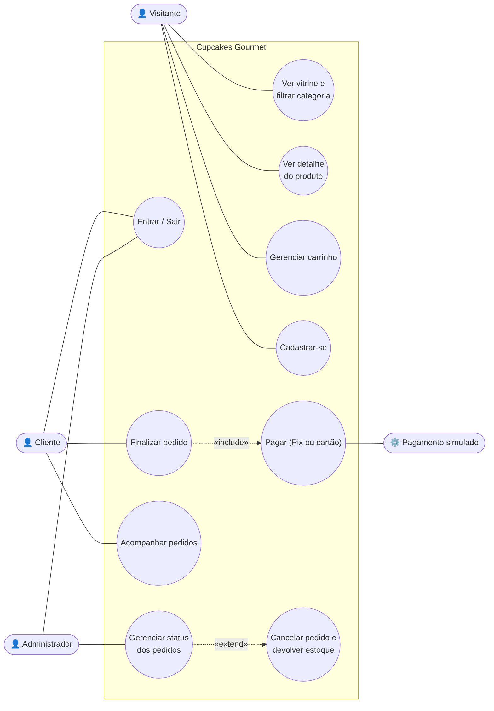
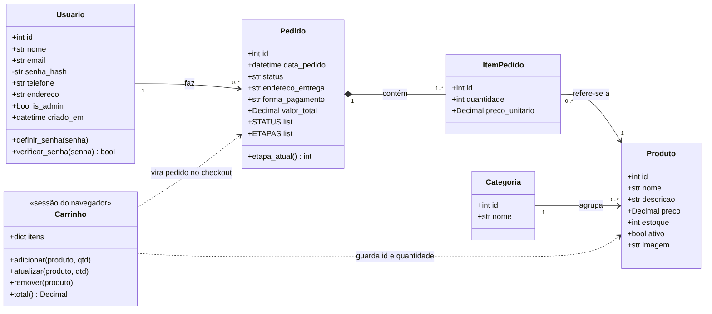
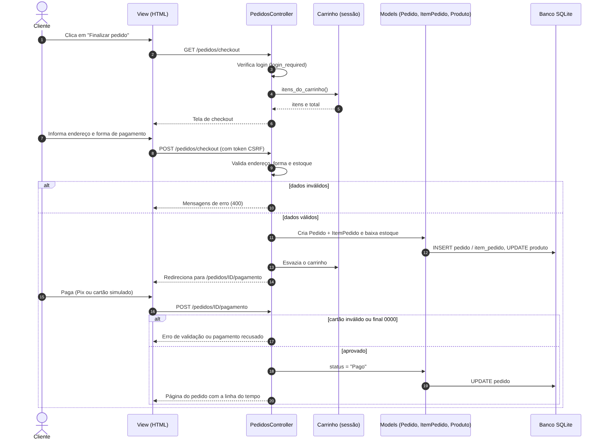
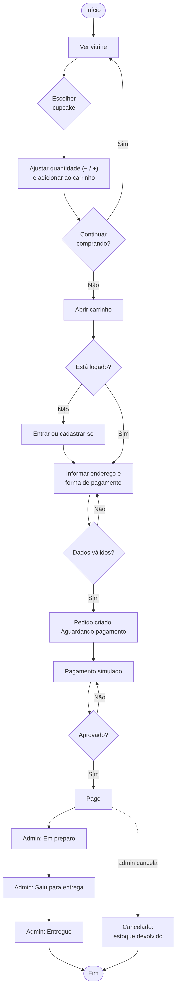

# 02 – Modelagem UML

Os diagramas foram revisados para refletir o sistema implementado. Os arquivos `.mmd` são o código-fonte dos diagramas (Mermaid) e podem ser editados e visualizados no próprio GitHub; as imagens estão na pasta `img/`.

## Diagrama de casos de uso
Atores: **Visitante** (navega sem login), **Cliente** (logado), **Administrador** e o **serviço de pagamento simulado**.

## Diagrama de classes
Classes persistentes (Model do MVC) e o carrinho, que fica na sessão do navegador até virar pedido.

**Decisões de modelagem**
- `ItemPedido.preco_unitario` guarda o preço **no momento da compra**, para o pedido não mudar se o preço do produto for alterado depois.
- `Pedido` e `ItemPedido` estão em **composição**: o item não existe sem o pedido.
- O **carrinho não é uma tabela**: ele fica na sessão do navegador e só é gravado no banco quando vira pedido.

## Diagrama de sequência – finalizar pedido e pagar

## Diagrama de atividades – ciclo do pedido

## Arquitetura MVC

| Camada | Pasta | Responsabilidade |
|---|---|---|
| **Model** | `backend/app/models/` | Entidades e acesso ao banco (SQLAlchemy) |
| **View** | `frontend/templates/` | Telas HTML (Jinja2 + Bootstrap) |
| **Controller** | `backend/app/controllers/` | Rotas, validações e regras de negócio |
