# 03 – IHC (Interface Humano-Computador)

## Mapa de navegação
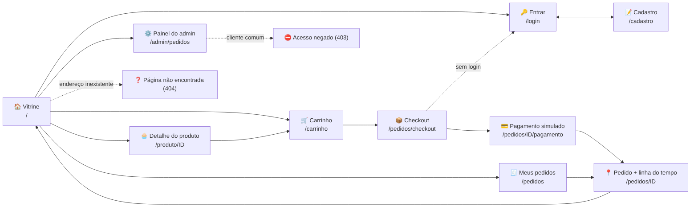

## Telas

| Tela | Computador / Celular |
|---|---|
| Vitrine com filtro e botões − / + | 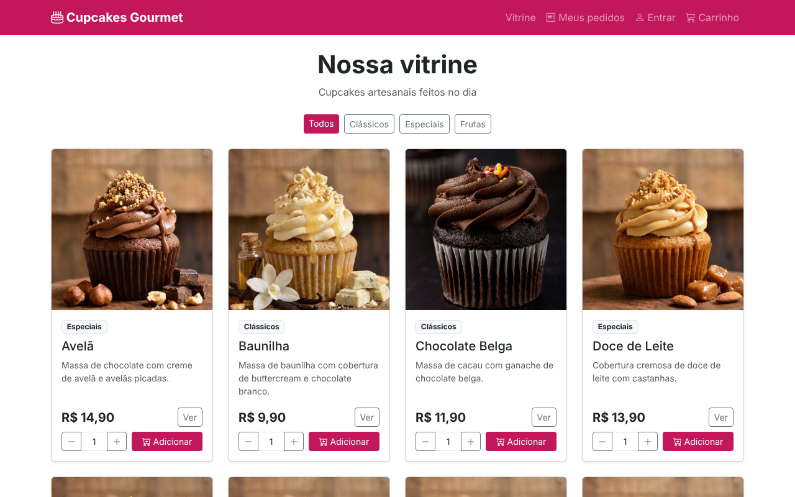 |
| Detalhe do produto | 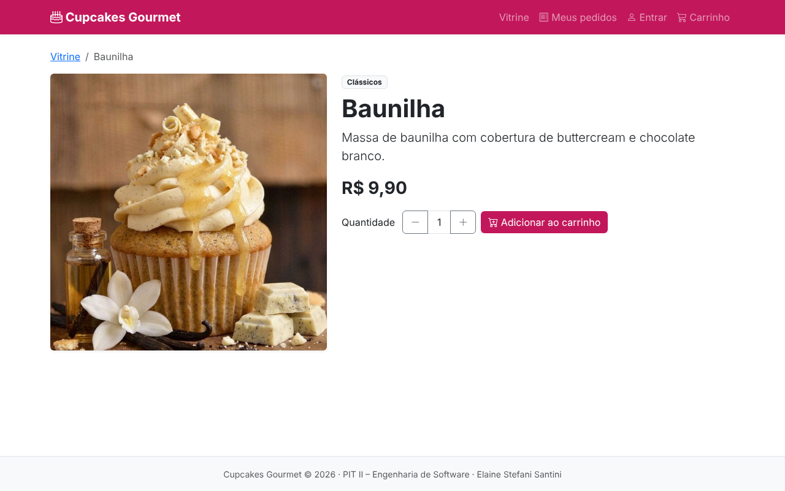 |
| Cadastro com mensagens de erro | 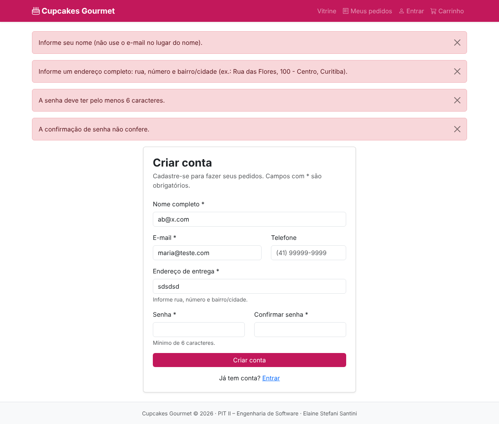 |
| Aviso "adicionado ao carrinho" sem sair da página | 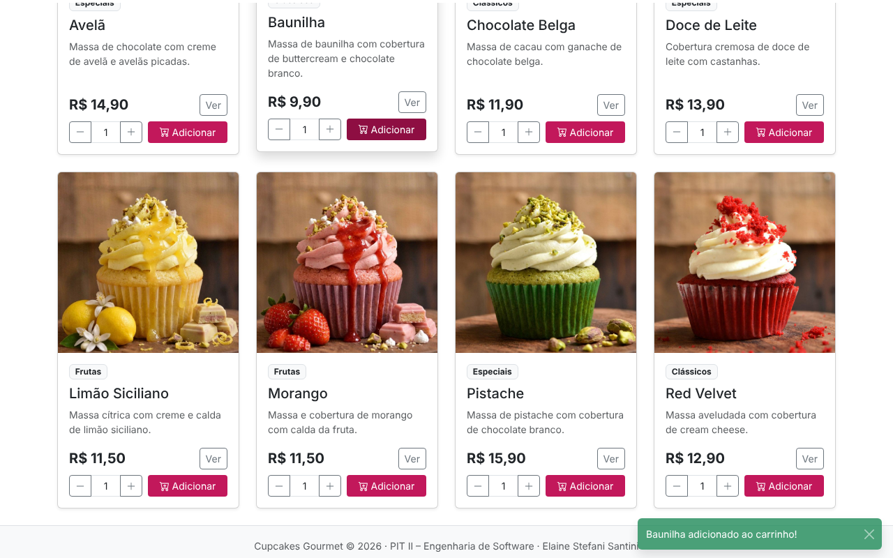 |
| Carrinho com total automático | 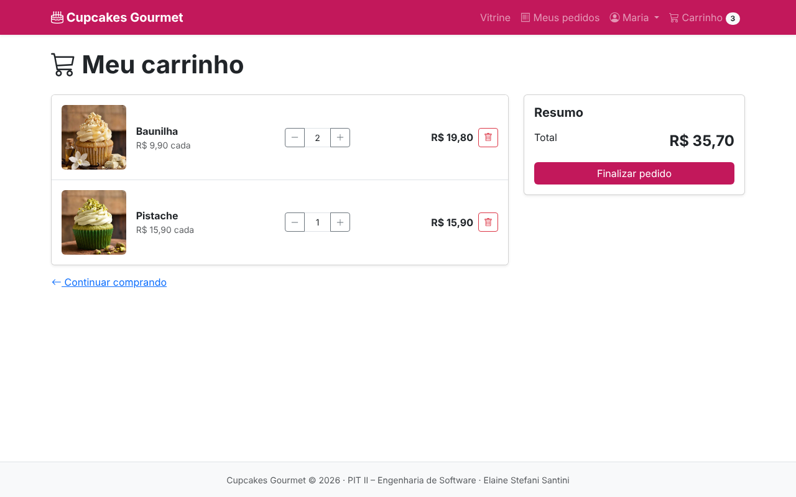 |
| Checkout | 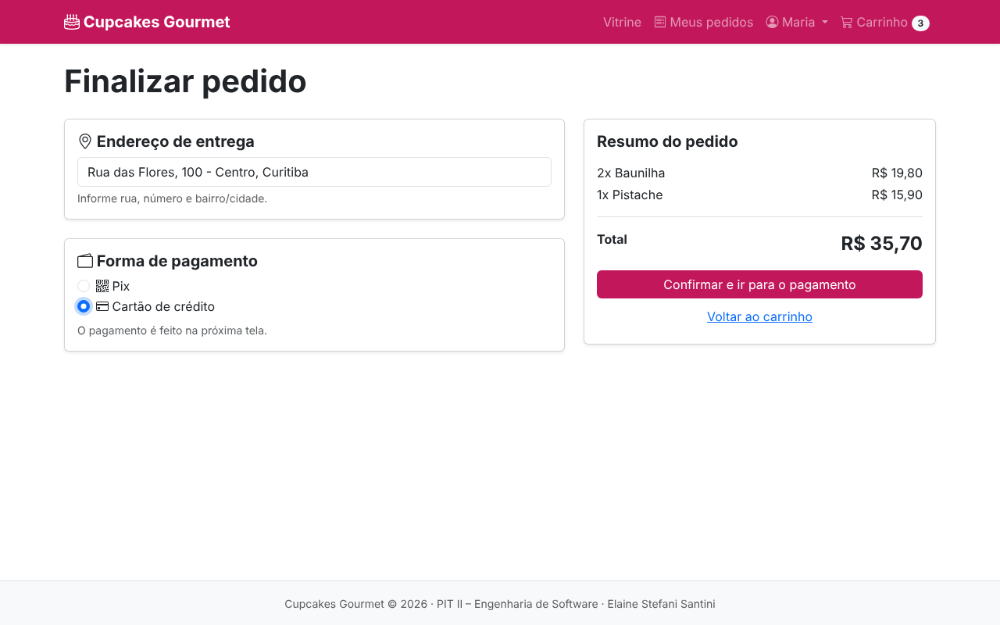 |
| Pagamento simulado recusado | 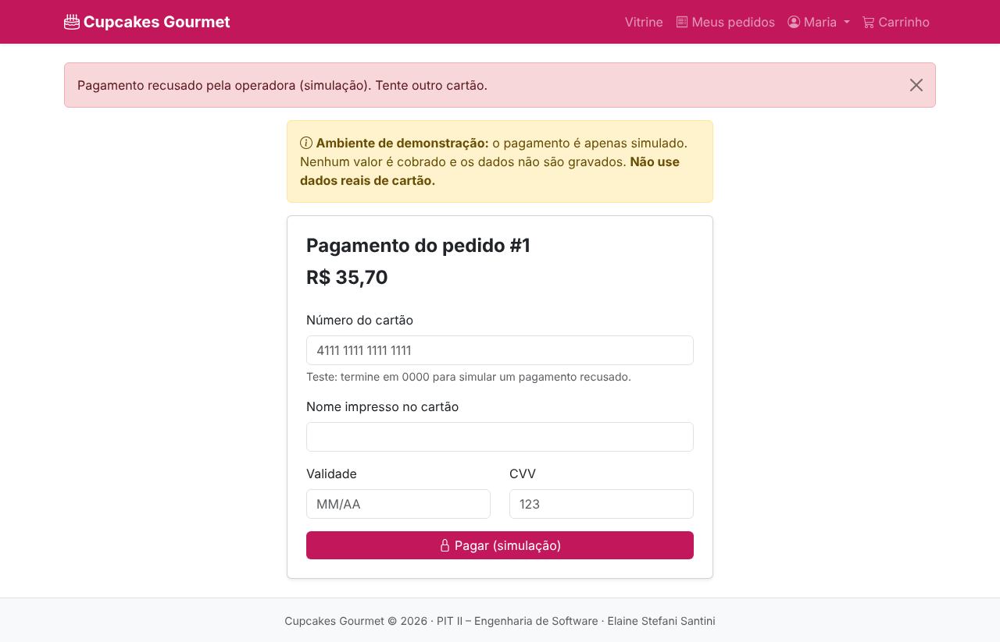 |
| Pedido com linha do tempo | 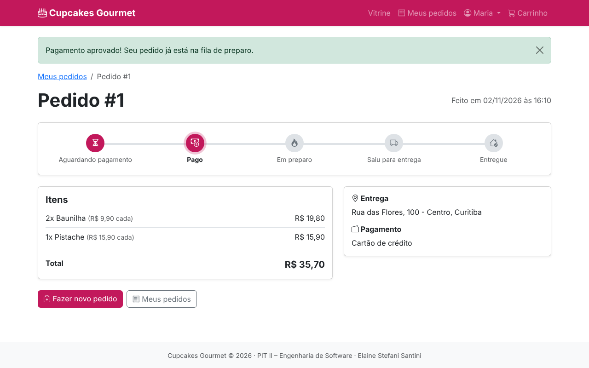 |
| Meus pedidos | 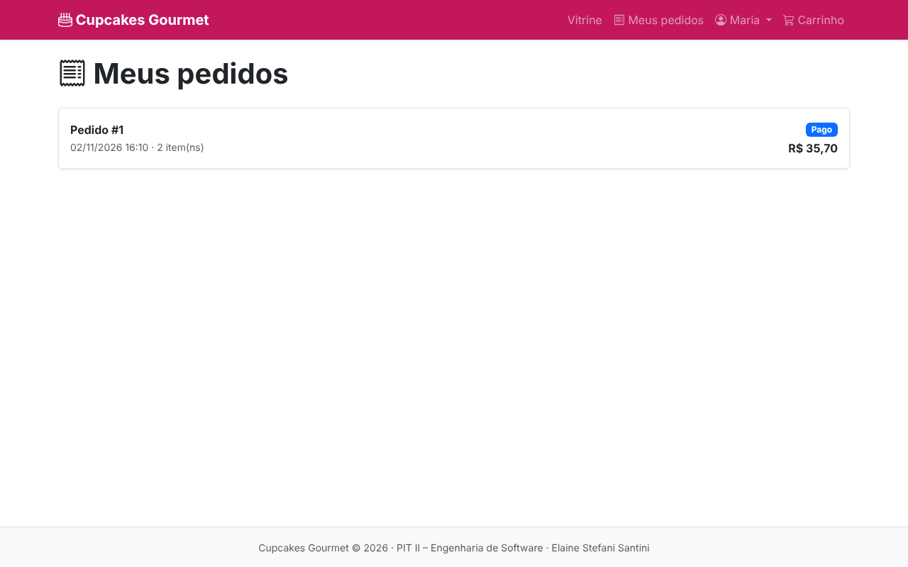 |
| Acesso negado (cliente no painel admin) | 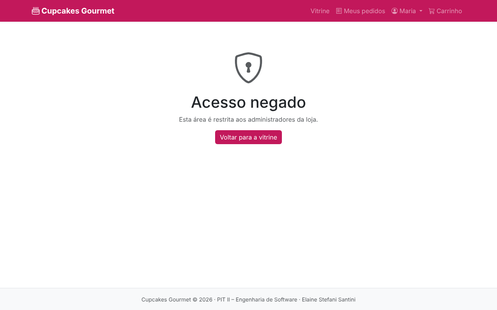 |
| Painel do administrador | 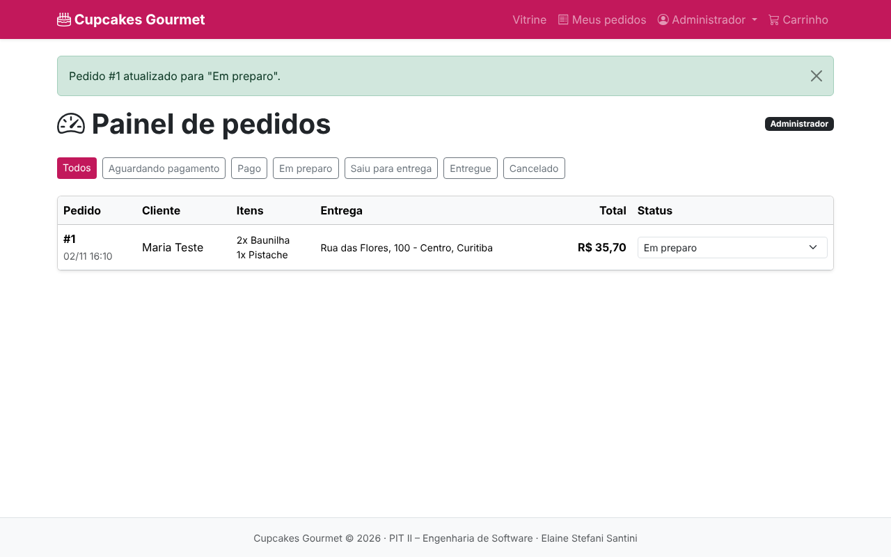 |
| Página não encontrada | 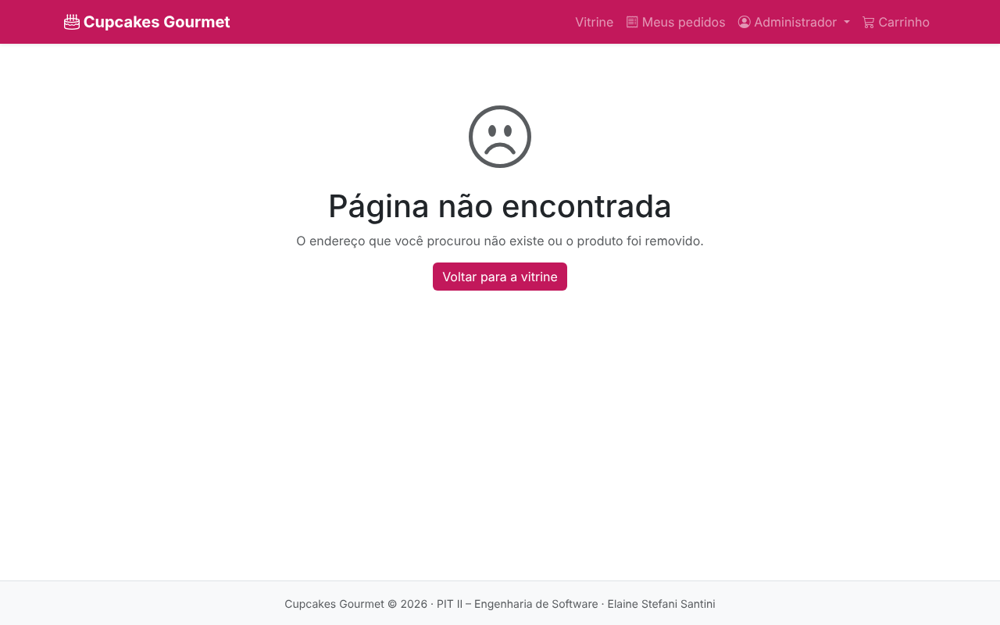 |
| Celular: vitrine | 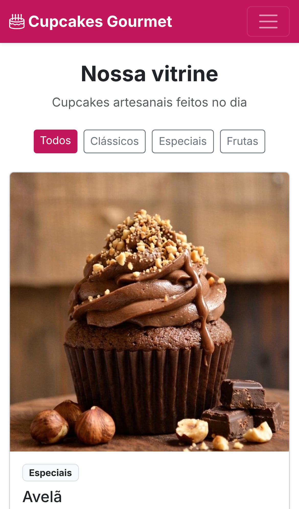 |
| Celular: carrinho | 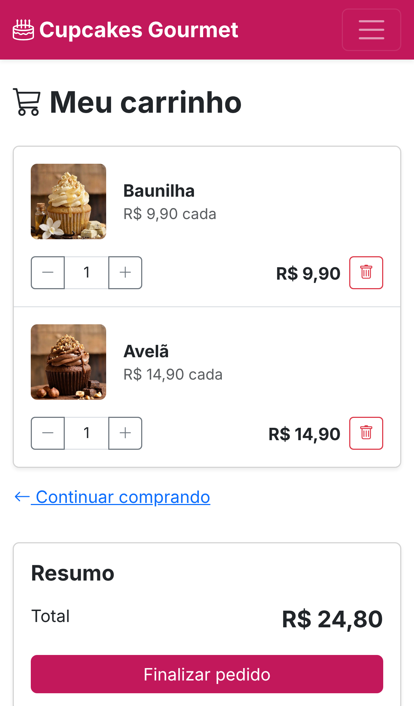 |

## Mensagens do sistema

| Situação | Mensagem | Tipo |
|---|---|---|
| Campos obrigatórios vazios | Preencha todos os campos obrigatórios. | Erro |
| Nome inválido ou e-mail no campo nome | Informe seu nome (não use o e-mail no lugar do nome). | Erro |
| Endereço incompleto | Informe um endereço completo: rua, número e bairro/cidade (ex.: Rua das Flores, 100 - Centro, Curitiba). | Erro |
| E-mail inválido / repetido | Informe um e-mail válido. / Este e-mail já está cadastrado. | Erro |
| Senha curta / diferente | A senha deve ter pelo menos 6 caracteres. / A confirmação de senha não confere. | Erro |
| Login incorreto | E-mail ou senha incorretos. *(genérica, não revela se o e-mail existe)* | Erro |
| Página protegida sem login | Faça login para continuar. | Aviso |
| Produto adicionado | {Produto} adicionado ao carrinho! | Sucesso |
| Acima do estoque | Temos apenas {N} unidades de {Produto} em estoque. | Aviso |
| Quantidade inválida | Quantidade inválida. Informe um número inteiro a partir de 1. | Erro |
| Sem forma de pagamento | Escolha a forma de pagamento. | Erro |
| Cartão com dados inválidos | O número do cartão deve ter 16 dígitos. / Informe a validade no formato MM/AA. / O CVV deve ter 3 dígitos. | Erro |
| Cartão final 0000 | Pagamento recusado pela operadora (simulação). Tente outro cartão. | Erro |
| Pagamento aprovado | Pagamento aprovado! Seu pedido já está na fila de preparo. | Sucesso |
| Status alterado (admin) | Pedido #{N} atualizado para "{status}". | Sucesso |
| Cancelamento (admin) | Confirmação antes de cancelar; pedido cancelado não pode ser reaberto. | Aviso |
| Formulário sem token / sessão expirada | Sua sessão expirou ou o formulário é inválido. Tente novamente. | Aviso |

## Princípios de usabilidade aplicados
- **Comunicar o que está acontecendo:** avisos de sucesso e erro em todas as ações; linha do tempo mostra a etapa atual do pedido.
- **Consistência:** mesma cor de botão principal, mesmo componente de quantidade (− / +) na vitrine, no detalhe e no carrinho.
- **Prevenção de erros:** quantidade limitada ao estoque, validação no navegador e no servidor, confirmação antes de cancelar um pedido.
- **Padrões pré-preenchidos:** o endereço do cadastro já vem preenchido no checkout; Pix vem selecionado.
- **Responsividade:** layout adaptado para celular; botões − / + substituem as setas do navegador, que não aparecem no celular.
- **Acessibilidade:** textos alternativos nas imagens e rótulos (`aria-label`) nos botões de ícone.
