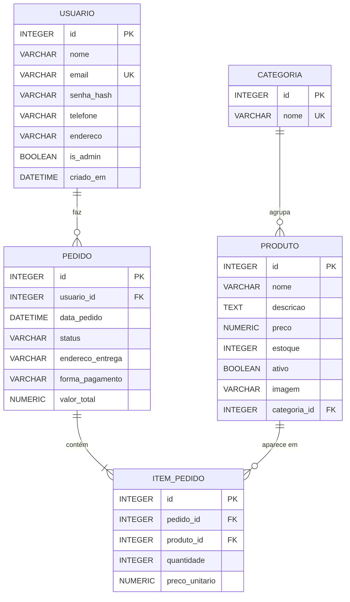

# 04 – Banco de dados

**SGBD:** SQLite, acessado pelo ORM SQLAlchemy. Como os models são independentes do banco, a troca para MySQL ou PostgreSQL exige apenas mudar `DATABASE_URL` em `backend/config.py`.

## 1. Projeto conceitual

| Entidade | Descrição | Relacionamentos |
|---|---|---|
| Usuário | Cliente ou administrador da loja | Faz 0..N pedidos |
| Categoria | Agrupamento dos cupcakes (Clássicos, Frutas, Especiais) | Agrupa 0..N produtos |
| Produto | Cupcake vendido na vitrine | Pertence a 1 categoria; aparece em 0..N itens |
| Pedido | Compra finalizada pelo cliente | Pertence a 1 usuário; contém 1..N itens |
| Item do pedido | Produto, quantidade e preço dentro de um pedido | Pertence a 1 pedido e a 1 produto |

O relacionamento **N:N entre Pedido e Produto** é resolvido pela entidade associativa **Item do pedido**.

## 2. Projeto lógico (DER)

### Normalização
- **1FN:** todos os atributos são atômicos (sem listas ou campos repetidos). Os itens do pedido ficam numa tabela própria, e não numa coluna com vários produtos.
- **2FN:** as chaves primárias são simples (`id`), então não há dependência parcial.
- **3FN:** não há dependência transitiva. Ex.: o nome da categoria fica em `categoria`, e `produto` guarda apenas `categoria_id`.
- **Desnormalizações intencionais:**
  - `item_pedido.preco_unitario` guarda o preço histórico (o preço do produto pode mudar depois da compra);
  - `pedido.valor_total` evita recalcular o total a cada consulta;
  - `pedido.endereco_entrega` guarda o endereço usado naquela entrega, que pode ser diferente do endereço do cadastro.

## 3. Projeto físico
Script completo: [`script-banco.sql`](script-banco.sql).

## 4. Dicionário de dados

### usuario
| Coluna | Tipo | Nulo | Chave | Descrição |
|---|---|---|---|---|
| id | INTEGER | Não | PK | Identificador do usuário |
| nome | VARCHAR(100) | Não | | Nome completo (validado: mínimo de 3 letras, não pode ser e-mail) |
| email | VARCHAR(120) | Não | UK | E-mail de login, único, gravado em minúsculas |
| senha_hash | VARCHAR(255) | Não | | Hash da senha (a senha nunca é gravada em texto) |
| telefone | VARCHAR(20) | Sim | | Telefone de contato |
| endereco | VARCHAR(255) | Sim | | Endereço padrão de entrega (rua, número e bairro/cidade) |
| is_admin | BOOLEAN | Não | | `1` = administrador, `0` = cliente |
| criado_em | DATETIME | Sim | | Data e hora do cadastro |

### categoria
| Coluna | Tipo | Nulo | Chave | Descrição |
|---|---|---|---|---|
| id | INTEGER | Não | PK | Identificador da categoria |
| nome | VARCHAR(50) | Não | UK | Nome da categoria |

### produto
| Coluna | Tipo | Nulo | Chave | Descrição |
|---|---|---|---|---|
| id | INTEGER | Não | PK | Identificador do produto |
| nome | VARCHAR(100) | Não | | Nome do cupcake |
| descricao | TEXT | Sim | | Descrição exibida na vitrine e no detalhe |
| preco | NUMERIC(8,2) | Não | | Preço atual em reais |
| estoque | INTEGER | Não | | Unidades disponíveis (baixa no checkout, devolução no cancelamento) |
| ativo | BOOLEAN | Não | | `0` oculta o produto da vitrine |
| imagem | VARCHAR(100) | Sim | | Nome do arquivo em `frontend/static/img/produtos/` |
| categoria_id | INTEGER | Não | FK → categoria.id | Categoria do produto |

### pedido
| Coluna | Tipo | Nulo | Chave | Descrição |
|---|---|---|---|---|
| id | INTEGER | Não | PK | Número do pedido |
| usuario_id | INTEGER | Não | FK → usuario.id | Cliente que fez o pedido |
| data_pedido | DATETIME | Sim | | Data e hora da criação |
| status | VARCHAR(30) | Não | | Aguardando pagamento, Pago, Em preparo, Saiu para entrega, Entregue ou Cancelado |
| endereco_entrega | VARCHAR(255) | Não | | Endereço desta entrega |
| forma_pagamento | VARCHAR(20) | Sim | | `PIX` ou `CARTAO` (simulados) |
| valor_total | NUMERIC(10,2) | Não | | Soma dos itens no momento da compra |

### item_pedido
| Coluna | Tipo | Nulo | Chave | Descrição |
|---|---|---|---|---|
| id | INTEGER | Não | PK | Identificador do item |
| pedido_id | INTEGER | Não | FK → pedido.id | Pedido ao qual o item pertence |
| produto_id | INTEGER | Não | FK → produto.id | Produto comprado |
| quantidade | INTEGER | Não | | Quantidade comprada (≥ 1) |
| preco_unitario | NUMERIC(8,2) | Não | | Preço do produto no momento da compra |

### Carrinho (não persistido)
O carrinho fica na **sessão do navegador** (cookie assinado), no formato `{"id_do_produto": quantidade}`, e só é gravado no banco quando o pedido é finalizado.
