# 06 – Laudo de qualidade

| | |
|---|---|
| **Sistema** | Cupcakes Gourmet – loja virtual de cupcakes |
| **Versão avaliada** | Publicada em https://nannesantin.pythonanywhere.com (29 e 30/10/2026) |
| **Responsável** | Elaine Stefani Santin – RGM 33146420 |
| **Testadores** | Suellen Priscilla de Camargo, Luiz Felipe Bini, Janaina Ferreira, Matheus Nunes, Thais Prado e Alyssa Mey Tsutsumi |
| **Instrumentos** | Formulário Google com roteiro de 12 passos, relatório em PDF de um testador, 58 testes automatizados (pytest) |

## 1. Resumo

- **6 testadores**, em celular e computador, com 3 navegadores diferentes (Chrome, Safari e Edge).
- **72 de 72** verificações do roteiro marcadas como "Funcionou": todas as funcionalidades principais estavam operando.
- **Facilidade de uso:** nota **5 de 5** em todas as respostas.
- Foram registrados **10 problemas** (de validação, segurança e usabilidade) e **4 sugestões de evolução**.
- **Todos os 10 problemas foram corrigidos**, com evidência visual (antes/depois) e/ou teste automatizado. As 4 evoluções foram registradas no backlog.
- Os testes automatizados passaram de **43 para 58**, cobrindo cada correção.

## 2. Problemas encontrados e correções

Severidade: **Alta** = risco de dados incorretos ou segurança; **Média** = atrapalha o uso; **Baixa** = melhoria de experiência.

| ID | Problema | Relatado por | Severidade | Causa | Correção | Status |
|---|---|---|---|---|---|---|
| L01 | Ao adicionar um cupcake ao carrinho, a página voltava ao topo | Suellen | Média | O formulário recarregava a página inteira | Adição em segundo plano (JavaScript + resposta JSON) com aviso no canto da tela; a página fica no mesmo lugar | ✅ Corrigido |
| L02 | Não era possível aumentar/diminuir 1 unidade de forma visível; as setas de quantidade não aparecem no celular | Suellen e autora | Média | Uso das setas nativas do campo numérico, que o celular não exibe | Componente próprio com botões **− e +** na vitrine, no detalhe e no carrinho | ✅ Corrigido |
| L03 | No carrinho, o total só mudava ao clicar no botão "atualizar" | Autora e Luiz Felipe | Baixa | Atualização dependia de enviar o formulário | Quantidade salva automaticamente ao clicar em − / +, com subtotal e total recalculados na hora | ✅ Corrigido |
| L04 | Quantidade inválida (0, −5, texto) era aceita como 1 ao alterar o campo pelo DevTools | Luiz Felipe | Alta | Validação só no navegador (`min=1`); o servidor corrigia o valor em silêncio | Validação no servidor: valores inválidos são recusados com "Quantidade inválida" e nada é adicionado | ✅ Corrigido |
| L05 | Endereço aceitava qualquer texto ("sdsdsd"), que aparecia nos pedidos | Luiz Felipe | Média | Só era verificado se o campo estava preenchido | Endereço exige rua, número e bairro/cidade, no cadastro e no checkout | ✅ Corrigido |
| L06 | E-mail aparecia no lugar do nome do cliente (pedido #5) | Luiz Felipe | Baixa | O testador digitou o e-mail no campo nome e o sistema aceitou | Nome validado: mínimo de 3 letras e não pode conter "@" | ✅ Corrigido |
| L07 | Formulários sem proteção CSRF | Luiz Felipe | Alta | Proteção não implementada | Flask-WTF (CSRFProtect): todos os formulários levam um token, e envios sem token são bloqueados | ✅ Corrigido |
| L08 | No painel do admin era preciso clicar no ✓ para salvar o status | Luiz Felipe | Baixa | Escolha e envio eram ações separadas | Status salvo ao escolher a opção; cancelamento pede confirmação | ✅ Corrigido |
| L09 | Página do pedido sem botão para voltar à vitrine | Luiz Felipe | Baixa | Não previsto no layout | Botões "Fazer novo pedido" e "Meus pedidos" | ✅ Corrigido |
| L10 | Ao alterar o status no painel do admin, o sistema voltava para a vitrine | Janaina | Média | O retorno usava o cabeçalho *Referer* do navegador, que pode não ser enviado ou ser reduzido ao domínio conforme o navegador e as configurações de privacidade. Não foi reproduzido no Chrome da autora | O formulário envia explicitamente a página de retorno (com o filtro aplicado); a proteção CSRF foi configurada para não exigir o Referer em HTTPS (correção preventiva) | ✅ Corrigido |

> A sugestão "mostrar confirmação na página do produto e atualizar o contador do carrinho" (Luiz Felipe) foi resolvida pela correção **L01**, pois ele testou a versão anterior a ela.

## 3. Evidências

### L01 – Página voltava ao topo
| Antes | Depois |
|---|---|
| 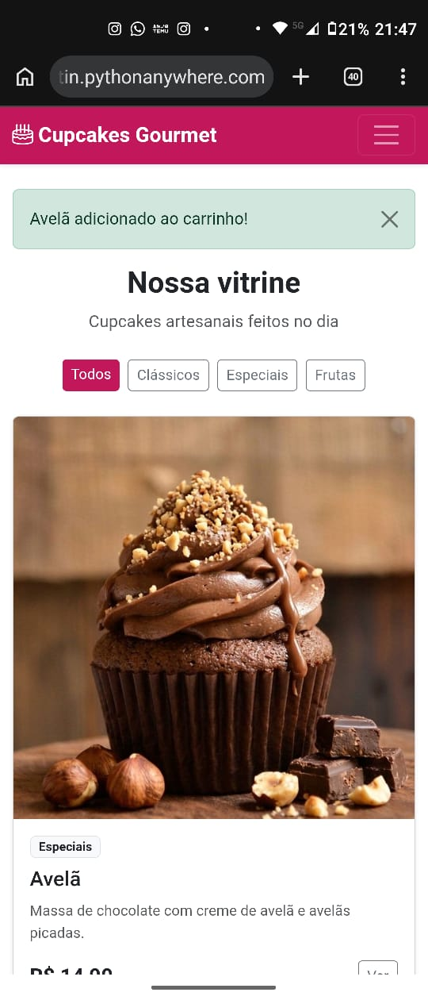 | 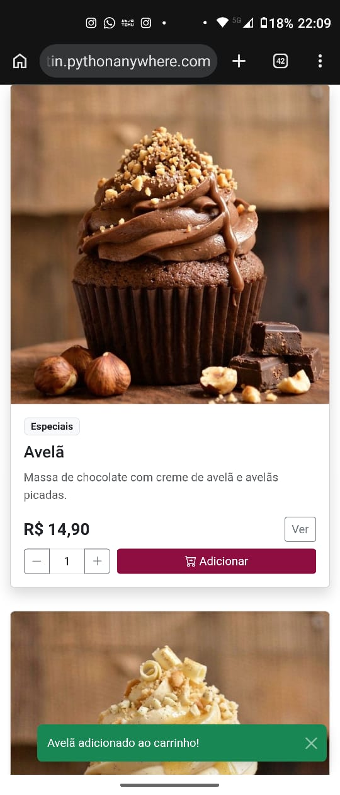 |
| Após adicionar, a página volta ao topo com a mensagem | O aviso aparece no canto e a tela continua no produto |

### L02 – Botões − e + no celular
| Antes | Depois |
|---|---|
| 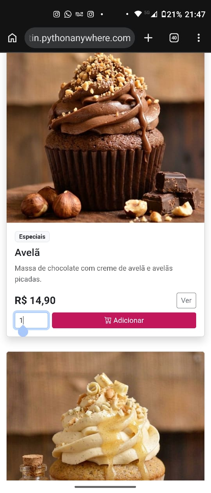 | 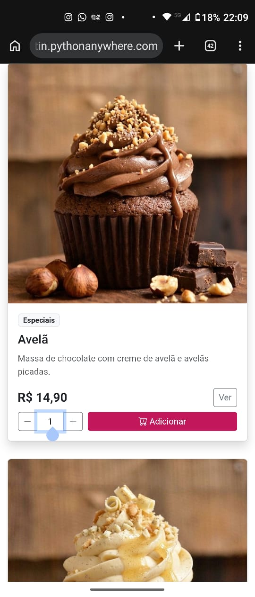 |
| Campo de quantidade sem setas no celular | Botões − e + visíveis |

### L03 – Total automático no carrinho
| Antes | Antes (após clicar em atualizar) | Depois |
|---|---|---|
| 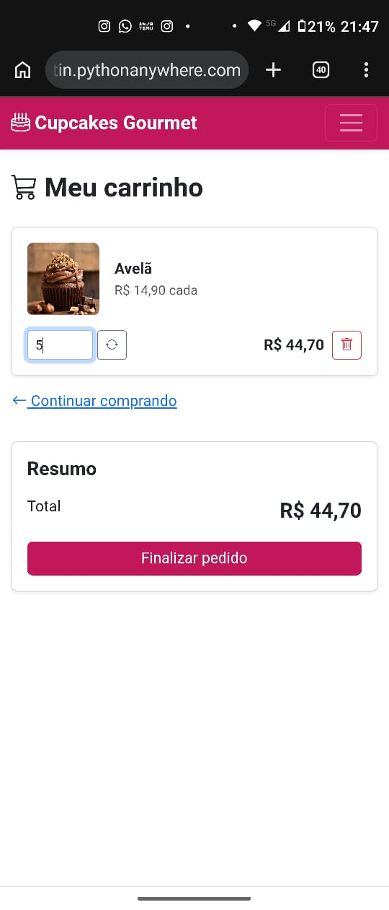 | 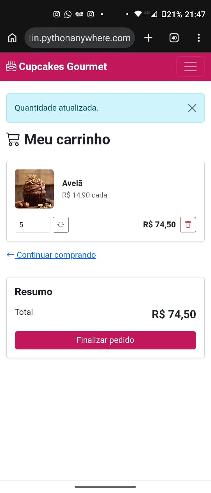 | 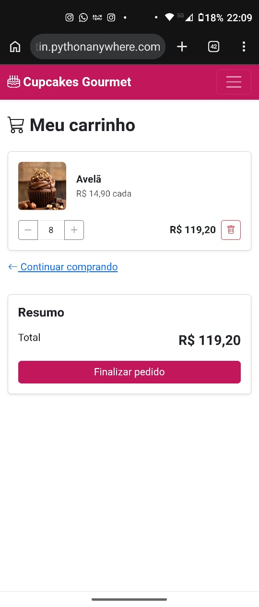 |
| Quantidade 5, total ainda de 3 unidades | Só atualiza após o botão ↻ | Total recalculado ao clicar em + |

### L04 – Quantidade inválida
| Antes | Depois |
|---|---|
| 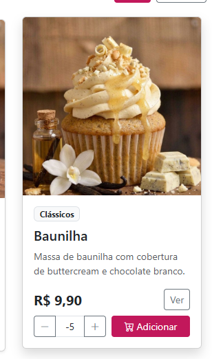 | 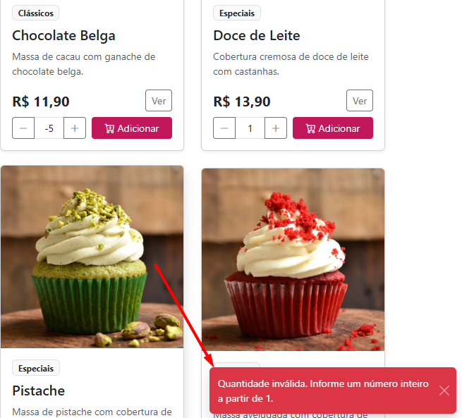 |
| Valor −5 enviado ao servidor | Servidor recusa e exibe "Quantidade inválida" |

### L05 – Endereço sem validação
| Antes | Depois |
|---|---|
| 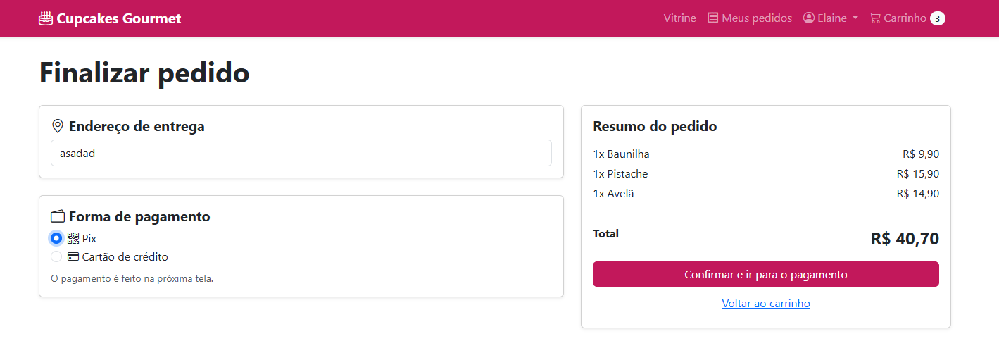 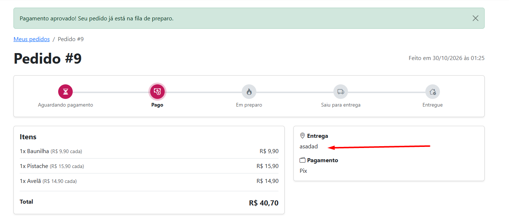 | 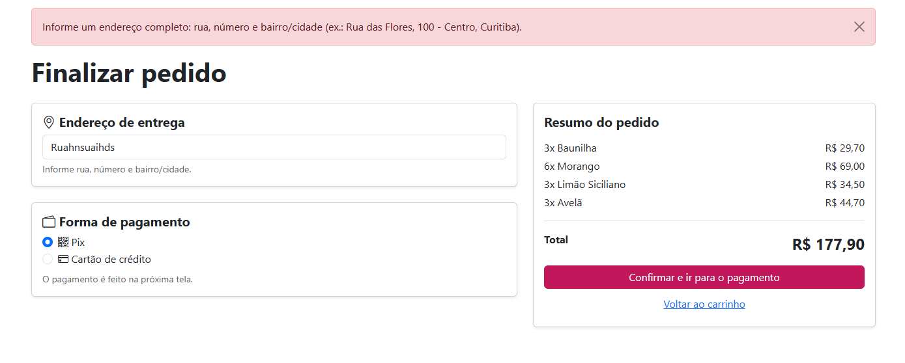 |
| "asadad" aceito e gravado no pedido #9 | Endereço incompleto recusado com orientação |

### L06 – E-mail no lugar do nome
| Antes | Depois |
|---|---|
| 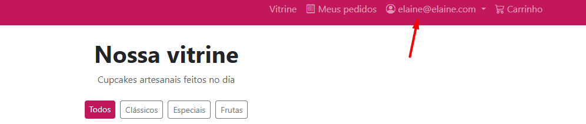 | 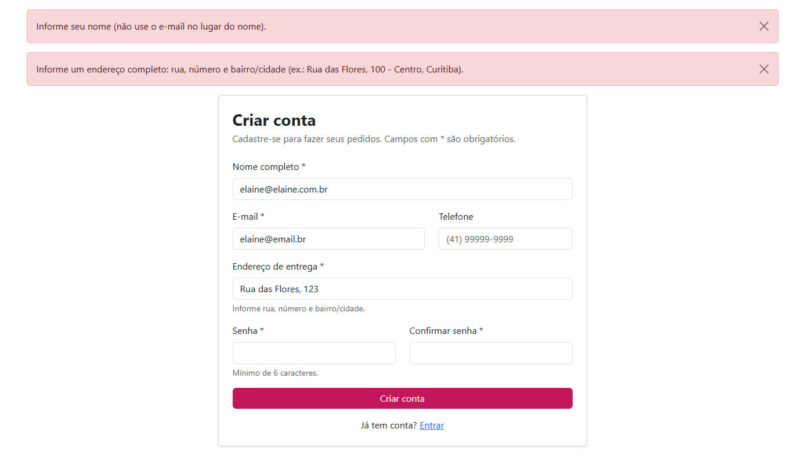 |
| Menu exibe o e-mail como nome | Cadastro recusa e-mail no campo nome |

### L07 – Proteção CSRF
Evidência por testes automatizados (`backend/tests/test_seguranca.py`):
- `test_formulario_sem_token_csrf_e_bloqueado` – envio sem token é recusado e o carrinho não muda;
- `test_paginas_com_formulario_enviam_token_csrf` – vitrine, produto, login e cadastro enviam o token.

### L08 – Salvar status ao escolher (admin)
| Antes | Depois |
|---|---|
| 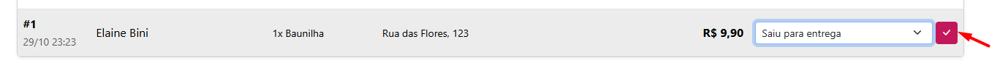 | 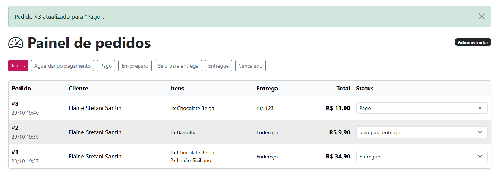 |
| Botão ✓ obrigatório | Salvo ao escolher; permanece no painel com confirmação |

### L09 – Botões na página do pedido
| Antes | Depois |
|---|---|
| 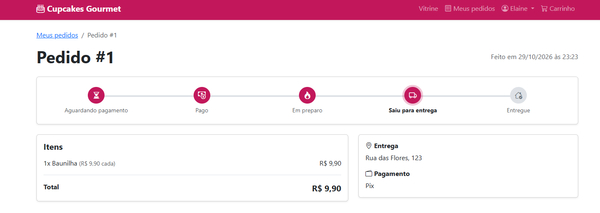 | 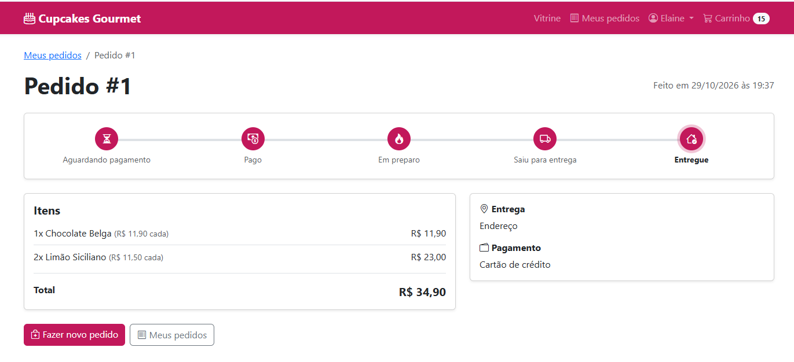 |

### L10 – Admin voltava para a vitrine
A imagem "depois" de L08 mostra o retorno ao **Painel de pedidos** após a alteração. Testes automatizados:
- `test_alterar_status_volta_para_o_painel_com_o_filtro`
- `test_alterar_status_sem_destino_volta_para_o_painel`
- `test_https_sem_referer_com_token_valido_e_aceito` (simula o navegador que não envia o Referer)

## 4. Sugestões registradas para evolução
| Sugestão | Relatado por | Decisão |
|---|---|---|
| Avaliação dos produtos pelos clientes | Alyssa | Backlog – evolução futura |
| Controle de estoque para o administrador | Alyssa | A baixa automática no checkout e a devolução no cancelamento **já existem**; a evolução é um painel de consulta e reposição de estoque |
| Busca de endereço por CEP | Luiz Felipe | Backlog – depende de serviço externo; a validação mínima de endereço foi implementada (L05) |
| Cadastro de produtos pelo administrador | Autora | Backlog – hoje os produtos vêm da carga inicial |

## 5. Conclusão
O sistema atende aos requisitos levantados no PIT I: vitrine, cadastro, carrinho, pedido, pagamento simulado, acompanhamento da entrega e administração. Todas as funcionalidades do roteiro foram aprovadas pelos seis testadores. Os problemas encontrados eram de validação, segurança e usabilidade, e nenhum impedia a compra. Todos foram corrigidos e cobertos por testes automatizados. Os testes com pessoas diferentes foram decisivos: o problema L10 só aparecia em alguns navegadores e não teria sido encontrado apenas com os testes da autora.
